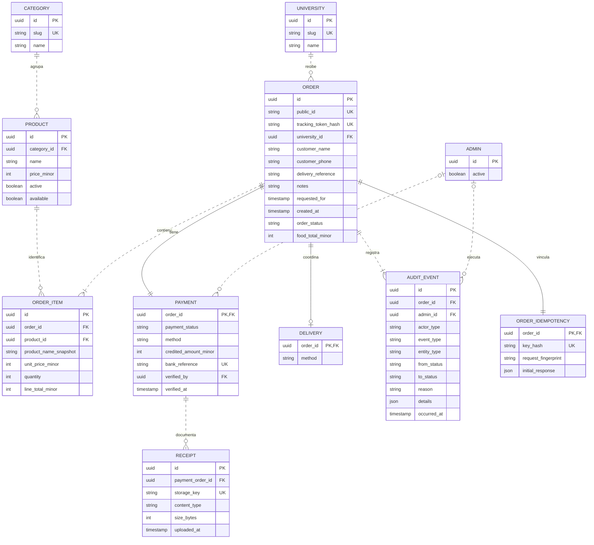

# Modelo de datos y estados de Pachamole

Diseño lógico de [F1-01 (#14)](https://github.com/maycol18ap/Pachamole/issues/14) basado en el acuerdo del chat 01, para revisión humana. Base de `main` registrada en `bb1e2d1e9b674c3f7dddda00612b963f23e5be52`.

El esquema físico, Prisma y las migraciones corresponden a [F1-02 (#15)](https://github.com/maycol18ap/Pachamole/issues/15). El formato de errores corresponde a [F1-04 (#17)](https://github.com/maycol18ap/Pachamole/issues/17). El cierre de F0 se sigue en [Estado actual](../planning/ESTADO_ACTUAL.md).

## Modelo entidad–relación



### Claves, cardinalidades y restricciones

| Relación | Cardinalidad y restricciones propuestas |
| --- | --- |
| Universidad → pedido | Cada pedido tiene exactamente una universidad. Una universidad puede tener cero o más pedidos. `UNIVERSITY.slug` es único y solo admite `udi`, `univalle` y `ucebol`. Express resuelve el `universityId` del contrato por su slug y persiste la FK interna. El pedido guarda los datos mínimos de contacto y entrega. El MVP funciona sin cuentas de cliente. |
| Categoría → producto | Cada producto pertenece a una categoría. Una categoría puede tener cero o más productos y `CATEGORY.slug` es único. Para retirar un producto del catálogo se desactiva y se conserva su identidad histórica. |
| Pedido → ítem ← producto | Un pedido confirmado tiene uno o más ítems. Cada ítem referencia un pedido y un producto. Un producto puede aparecer en cero o más ítems. `UNIQUE(order_id, product_id)` tras consolidar cantidades repetidas. |
| Pedido → pago | Exactamente un pago por pedido. `PAYMENT.order_id` es PK y FK a la vez. Se crea en `pending`, con método fijo `qr`, junto con el pedido. |
| Pago → comprobante | Un pago puede tener cero o más comprobantes privados. Cada comprobante pertenece a un único pago. Una nueva subida agrega un registro y conserva la trazabilidad de las anteriores según la política de retención. |
| Pedido → entrega | Cero o una entrega con PK y FK compartida. Administración registra `walking` o `external`. El avance de la entrega se refleja en `ORDER.order_status`. |
| Pedido → evento ← admin | Cada evento pertenece a un pedido y el pedido tiene al menos su evento de creación. Un admin puede originar cero o más eventos. La FK al admin es obligatoria para actor `admin` y nula para `customer` o `system`. |
| Admin → pago | Cada pago tiene cero o un admin verificador. Un admin puede verificar cero o más pagos. Al confirmar el abono en banca, se guardan admin, fecha y monto acreditado, incluso si el pedido ya está cancelado. La referencia bancaria se guarda cuando existe. |
| Pedido → idempotencia | Exactamente un registro por pedido creado por `POST /api/orders`. La PK compartida impide asociar varias claves al mismo pedido. El hash único impide que una misma clave cree varios pedidos. |

- Las FK que sostienen el historial restringen el borrado de registros referenciados. Un pedido `cancelled` se conserva junto con sus ítems, pago y eventos. Se desactiva a los administradores que pierdan acceso para conservar la autoría.
- Los estados de pedido y pago admiten los valores de sus matrices respectivas. `quantity` es un entero positivo. Los precios y totales son enteros no negativos. Express valida límites de cantidades e importes antes de escribir para mantener los resultados dentro del rango de almacenamiento.
- `notes` y `bank_reference` son opcionales. Los campos de verificación se completan juntos al confirmar un abono. Un pago `verified` exige `credited_amount_minor = food_total_minor` del pedido. Con una sola cuenta receptora, basta una restricción única sobre `bank_reference` cuando está informada. Si la referencia ya pertenece a otro pedido, el admin registra una incidencia. Cuando falta una referencia utilizable, el admin solo verifica si puede identificar el movimiento y descartar un uso previo.
- Express valida universidad, contacto, cantidades y horario. `requested_for` se persiste como instante con zona horaria y se valida en `America/La_Paz`, con atención de 11:00 a 22:00 y tiempo de preparación y capacidad disponibles. Las franjas y cupos exactos quedan pendientes de definición operativa.
- La BD impone PK, FK, unicidad y restricciones de cada fila. El mínimo de ítems, la existencia del pago y del evento inicial, la igualdad de importes entre tablas y las transiciones se garantizan dentro de las transacciones de Express.

## Snapshots y cálculo de comida

Al registrar el pedido, Express consulta el catálogo persistido y valida que todos los productos estén activos y disponibles, incluidas las cantidades cuando se controla stock. La lectura del catálogo y las validaciones de disponibilidad deben mantenerse consistentes ante ediciones o pedidos concurrentes. Cada ítem guarda nombre, precio unitario vigente, cantidad y subtotal en el momento del registro. El importe esperado del pago se toma de `food_total_minor` del pedido.

```text
line_total_minor = unit_price_minor × quantity
food_total_minor = suma de line_total_minor del pedido
```

Todos los importes se calculan en centavos de boliviano mediante aritmética entera y se conservan al confirmar la creación. Los cambios del catálogo afectan a pedidos nuevos. Los reintentos y las consultas posteriores leen los snapshots del pedido ya registrado. El QR cubre exclusivamente `food_total_minor`. El envío de referencia de Bs 5–10 se coordina y se paga aparte. Los importes enviados por el cliente carecen de autoridad sobre el cálculo.

## Registro del pedido y pago manual por QR

1. Desde el carrito, el cliente completa y confirma los datos del pedido y pulsa **Pedir**. React envía `POST /api/orders`. Express calcula el total de comida con los precios vigentes del catálogo y registra el pedido junto con su pago `pending`.
2. Tras la respuesta exitosa, React navega a `/pedido/:token`, la vista de seguimiento del pedido registrado. Allí muestra el ID público, el QR del titular de la cuenta receptora y el importe exacto de comida. El botón **Contactar por WhatsApp** es opcional y abre la conversación solo al pulsarlo, con un mensaje prellenado que incluye el ID público del pedido. El cliente puede continuar en la vista de seguimiento y transferir desde su banca sin abrir WhatsApp.
3. El cliente usa el enlace privado para adjuntar el comprobante al pedido existente. Una subida válida deja el pago en `under_review` y conserva el estado del pedido.
4. Solo un admin autenticado y autorizado en Express puede marcar `verified`. Para hacerlo identifica el abono real en banca, comprueba que corresponde a ese pedido y coteja el importe exacto de comida. El monto por sí solo es insuficiente para asignar el abono. Cuando existe una referencia bancaria utilizable, se registra y se comprueba que ese movimiento no esté aplicado a otro pedido.
5. Si el abono falta, el importe difiere o no se puede vincular el movimiento de forma inequívoca, el admin registra el motivo y pasa el pago a `issue`. La incidencia se coordina manualmente por WhatsApp usando el ID público del pedido.

## Token privado y comprobantes

- Express genera un token opaco con un generador criptográfico de 32 bytes aleatorios y lo codifica en base64url. Conserva un hash SHA-256 único en el pedido para localizarlo. El `public_id` legible identifica el pedido para coordinación y carece de permisos por sí mismo.
- `GET /api/orders/track/:token` devuelve solo ID público, estados y total de comida tras validar el token. Un token inválido o desconocido recibe `404` con respuesta genérica. Se limita la frecuencia, se desactiva la caché de la respuesta y se omite el token de logs, trazas y mensajes de WhatsApp. La respuesta pública excluye contacto, referencia de entrega, comprobantes, referencias bancarias y auditoría.
- `POST /api/orders/track/:token/receipt` valida el token, el estado del pedido y los límites de subida. El servidor comprueba tamaño y contenido real, admite JPG/PNG con límite inicialmente propuesto de 5 MiB y usa una clave de almacenamiento aleatoria. Solo administración autenticada y autorizada en Express accede al archivo privado, mediante el servidor o un enlace temporal controlado.

## Compatibilidad con idempotencia

`POST /api/orders` recibe un `Idempotency-Key` aleatorio de alta entropía por intento. La BD impone unicidad sobre el hash de la clave. Express usa una huella SHA-256 del cuerpo validado y normalizado para distinguir un reintento de un envío distinto. Los precios del catálogo se calculan al crear el pedido y quedan fuera de la huella.

Express busca un intento confirmado antes de volver a comprobar disponibilidad u horario. La misma clave y huella devuelven el `201` y cuerpo originales, incluso si cambian el precio, la disponibilidad o los estados. La misma clave con una huella distinta devuelve `409`. La restricción única resuelve los intentos concurrentes. Si una escritura pierde ese conflicto, Express revierte la transacción y consulta el registro confirmado para aplicar la misma regla.

El primer intento válido registra pedido, ítems, pago inicial, evento de creación y registro idempotente en una transacción. `initial_response` guarda el cuerpo mínimo del `201`, incluido el token original para recuperar el enlace en un reintento. Express es el único que accede al registro privado. La clave, la huella y el token se excluyen de los logs. El seguimiento sigue consultando por el hash del token guardado en el pedido.

## Matriz de estados del pedido

Las columnas del panel admin corresponden a `order_status`: `pending`, `scheduled`, `preparing`, `ready`, `on_the_way`, `delivered` y `cancelled`. El panel muestra `payment_status` por separado. `delivered` y `cancelled` son terminales. Cada cambio de estado permitido genera un evento de pedido y los cambios administrativos exigen sesión y permiso comprobados en Express.

| Desde | Hacia | Actor | Condición | Efecto |
| --- | --- | --- | --- | --- |
| Sin pedido | `pending` | Cliente, mediante Express | Registro válido, disponibilidad y horario comprobados, intento nuevo | Crea pedido, ítems, pago `pending`, token, idempotencia y evento inicial de forma atómica. |
| `pending` | `scheduled` | Admin | Pago `verified` y preparación prevista para una franja futura | Registra la espera del pedido programado. |
| `pending`, `scheduled` | `preparing` | Admin | Pago `verified` y corresponde iniciar según horario y tiempo de preparación | Inicia preparación. Conserva el pago `verified`. |
| `preparing` | `ready` | Admin | Preparación terminada | Marca el pedido listo para despacho. |
| `ready` | `on_the_way` | Admin | Entrega con método definido y despacho iniciado | Registra la salida del pedido. |
| `on_the_way` | `delivered` | Admin | Entrega confirmada | Cierra el flujo operativo. |
| `pending`, `scheduled`, `preparing`, `ready`, `on_the_way` | `cancelled` | Admin | Incidencia operativa y motivo obligatorio | Conserva pedido e historial. Si el pago está `verified`, pasa a `refund_pending` con su propio evento en la misma transacción. |

Confirmar el abono actualiza el pago. Pasar a `scheduled` o iniciar preparación requiere una acción administrativa del pedido. En `PATCH /api/admin/orders/:id/status`, si se solicita `preparing` con pago `under_review`, Express devuelve `409`, conserva ambos estados y no inserta un evento de transición exitosa. La misma guarda rechaza también los pagos `pending`, `issue` y `refund_pending`.

## Matriz de estados del pago

| Desde | Hacia | Actor | Condición | Efecto |
| --- | --- | --- | --- | --- |
| Sin pago | `pending` | Express, por registro del cliente | Pedido válido de un intento nuevo | Crea el pago QR junto con el pedido. |
| `pending` | `under_review` | Cliente con token válido | Pedido abierto y comprobante válido guardado en privado | Registra el adjunto y el evento de revisión. |
| `issue` | `under_review` | Admin | Pedido abierto y motivo de reapertura | Registra la reapertura. |
| `under_review` | `issue` | Admin | Pedido abierto y abono ausente, importe inconsistente o movimiento que no se puede vincular inequívocamente al pedido | Registra el motivo y habilita el seguimiento manual por WhatsApp. |
| `under_review`, `issue` | `verified` | Admin | Pedido abierto y abono real identificado en banca, atribuible a ese pedido, sin asignación previa y por el importe exacto de comida | Persiste actor, fecha, monto y referencia disponible. Registra evento de verificación. El estado del pedido se conserva. |
| `verified` | `refund_pending` | Admin, mediante cancelación | Se cancela un pedido con abono verificado | Conserva la verificación y deriva a resolución manual. Registra el cambio junto con el evento de cancelación. |
| `pending`, `under_review`, `issue` | `refund_pending` | Admin | Pedido `cancelled` y abono posterior confirmado en banca, atribuible a ese pedido y sin asignación previa | Registra monto, referencia disponible, actor, fecha y motivo en la misma transacción. El pedido sigue `cancelled` y el abono queda pendiente de resolución manual. |

Una captura únicamente aporta evidencia para revisión. Si se admite otro comprobante durante la revisión, se registra un adjunto y su evento sin cambiar `under_review`. La verificación bancaria requiere una acción explícita de administración. Las confirmaciones repetidas conservan la verificación original y no generan un segundo evento exitoso. `refund_pending` deja constancia de una incidencia de un pedido cancelado. Administración coordina manualmente la resolución y cualquier devolución que corresponda. Para ambas matrices, las transiciones que no figuran se rechazan como conflicto de estado.

## Auditoría transaccional

`AUDIT_EVENT` es un registro de solo anexado. Guarda pedido, entidad afectada, acción, estado de origen y destino cuando corresponda, actor, fecha y motivo. El evento de creación registra los estados iniciales. La verificación bancaria agrega monto y referencia comprobada cuando está disponible. Cancelación e incidencias requieren motivo. La referencia bancaria y los detalles operativos se limitan a acceso administrativo autorizado. Los eventos excluyen datos de contacto, credenciales, tokens, archivos y textos libres del cliente.

El cambio de estado y su evento se confirman en la misma transacción. Para iniciar preparación, Express comprueba el pago vigente y actualiza el pedido solo si conserva un estado de origen permitido. La verificación del pago y la cancelación también validan ambos estados dentro de la transacción. Ante un conflicto concurrente, se vuelve a validar la transición o se rechaza la operación. Si una condición falla o alguna escritura da error, se revierte la operación completa. F1-02 debe probar estos casos con transacciones de Prisma y actualizaciones condicionadas al estado previo cuando corresponda.

El almacenamiento de objetos queda fuera de la transacción BD. Tras guardar un comprobante en privado, Express registra sus metadatos, el cambio de revisión si corresponde y el evento en una transacción. Si se revierte, se elimina el objeto huérfano o se programa su limpieza. El éxito de la subida se comunica tras confirmar la BD.

## Casos de aceptación para la implementación

| Caso | Acción | Resultado esperado |
| --- | --- | --- |
| Preparación bloqueada | Con pedido `pending` y pago `under_review`, un admin solicita `preparing`. | HTTP `409`. El pedido sigue `pending`, el pago sigue `under_review` y se conserva el número de eventos exitosos. |
| Preparación con pago verificado | Con pedido `pending` y pago `under_review`, un admin verifica en banca el abono por el total de comida y luego solicita `preparing` en la franja permitida. | Primero, el pago pasa a `verified`, el pedido sigue `pending` y se registra un evento de pago. Después, el pedido pasa a `preparing`, el pago sigue `verified` y se registra un evento de pedido. |
| Precio posterior distinto | Registrar dos unidades a Bs 25,00 (2.500 centavos) y luego cambiar el producto a Bs 30,00. | El pedido original conserva 2.500 centavos por unidad y Bs 50,00 (5.000 centavos) de subtotal y total de comida, sin incluir el envío. El reintento con la misma clave repite la respuesta original. Un pedido nuevo equivalente calcula Bs 60,00. |
| Token inválido | Consultar seguimiento con un token incorrecto o con el ID público en lugar del token. | HTTP `404` genérico y cero datos del pedido, comprobantes o contacto. |
| Reintento y concurrencia | Enviar dos registros idénticos con la misma clave y después reutilizarla con otra cantidad. | Se confirma un solo pedido con un único pago y evento inicial. Las dos solicitudes idénticas obtienen el mismo `201` original. La solicitud con cuerpo distinto recibe `409`. |
| Dos pedidos del mismo importe, un solo abono | Dos pedidos por Bs 50,00 tienen pagos `under_review` y en banca figura una sola transferencia por Bs 50,00. | Si el admin vincula el abono de forma inequívoca, verifica únicamente ese pedido y registra el otro en `issue`. Si no puede determinar a cuál corresponde, registra ambos en `issue` para seguimiento manual. El mismo movimiento solo puede respaldar un pedido, incluso con revisiones concurrentes. |
| Acreditación posterior a la cancelación | Un pedido se cancela mientras el pago sigue `under_review`. Luego el admin identifica en banca un abono posterior que corresponde a ese pedido. | El pedido permanece `cancelled`. El pago pasa directamente a `refund_pending` con un evento que registra el actor, fecha, monto, motivo y referencia disponible. El caso se deriva a resolución manual. |

## Decisiones propuestas para revisión

- Usar la referencia bancaria disponible para una sola cuenta receptora y conservar la auditoría de incidencias. El soporte para varias cuentas y las políticas avanzadas de reserva o retención de referencias en `refund_pending` quedan como opciones futuras.
- Llevar el abono confirmado después de la cancelación directamente a `refund_pending` para resolución manual, conservando el pedido cancelado.
- Mantener la idempotencia con una clave única y la respuesta inicial privada. El cifrado de esa respuesta en la BD, el uso de HMAC y los bloqueos explícitos o mecanismos adicionales de serialización quedan como opciones si la implementación los necesita.
- Persistir el subtotal del ítem junto al precio unitario y consolidar productos repetidos antes de registrar el pedido.

El revisor humano valida el ER y ambas matrices contra la especificación y el contrato. Los casos de aceptación quedan como base de pruebas para la implementación posterior.

Fuentes en `main` de la base indicada. [AGENTS.md](../../AGENTS.md), [SPEC_MVP](../product/SPEC_MVP.md), [API_CONTRATO](API_CONTRATO.md), [DECISIONES](DECISIONES.md), [BASELINE](../security/BASELINE.md) y [ESTADO_ACTUAL](../planning/ESTADO_ACTUAL.md).
